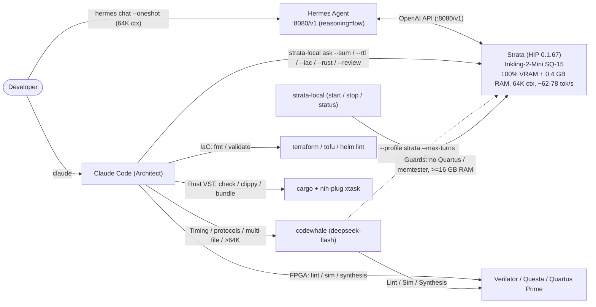

# 9070FpgaIAWorkflow — Hybrid Local & Cloud AI Workflow (RX 9070 XT 16 GB)

Base setup, project rules, and workflow documentation for developing **openFPGA** cores (Analogue Pocket / Intel Cyclone V), **DevOps/IaC** (Terraform/OpenTofu, Kubernetes/Helm, Ansible), and **Rust VST3/CLAP** audio plugins (`nih-plug`) using **Claude Code** and **Hermes Agent** assisted by a local GPU minion (**Strata** running **`Inkling-2-Mini SQ-15`** 100% inside the **AMD Radeon RX 9070 XT 16 GB VRAM**) and **`codewhale`** (`deepseek-flash`) for autonomous multi-file edits and >64K context escalation on **Arch Linux**.

---

## Repository Structure

```text
.
├── .gitignore                  # Quartus artifacts, simulation files (Verilator/Questa), and local configs
├── AGENTS.md                   # Model routing rules and strict Cyclone V synthesis guidelines
├── CLAUDE.md                   # Claude Code rules for offloading bounded work to Strata / codewhale
├── README.md                   # Environment, lifecycle scripts, and workflow guide
├── scripts/
│   └── strata-local            # Strata lifecycle + `ask` minion (install to ~/.local/bin)
├── skills/
│   └── hybrid-local-ai/        # Claude Code skill: hybrid routing for FPGA, DevOps/IaC and Rust VST (install to ~/.claude/skills)
└── docs/
    └── ai-fpga-workflow.md     # Hybrid workflow diagrams and hardware resource allocation
```

---

## Architecture: Strata (`Inkling-2-Mini SQ-15`) + Hermes Agent + Claude Code + `codewhale`

In this setup, **[Strata](https://github.com/Niko1221/Strata)** (`inkling2` engine `0.1.67`) serves **`Inkling-2-Mini-SQ-15`** (26.4B MoE / 3.4B active, embedded DSpark drafter, **64K context**) **100% inside the RX 9070 XT's 16 GB VRAM** (`11.86 GB` experts + DSpark in VRAM, `~0.42 GB` in RAM), leaving **~45–58 GB of DDR5 RAM free** for Quartus Prime and Verilator/Questa, and delivering **~62–78 tok/s** steadily on `http://127.0.0.1:8080/v1`.

- **`strata-local ask`** ([`scripts/strata-local`](./scripts/strata-local)): Direct `stdin`/file CLI minion for Claude Code (`--sum`, `--rtl`, `--iac`, `--rust`, `--review`). Uses `reasoning_effort=none` by default for fast responses (`--think` opts in).
- **Hermes Agent** (`/usr/bin/hermes`): Local tool-calling agent connected to Strata (`http://127.0.0.1:8080/v1`, `inkling-2-mini-sq-15`, `64K` ctx, `agent.reasoning_effort: low`) for single-file / bounded tasks (`hermes chat -q "..." --oneshot`).
- **`codewhale`** (default `deepseek-flash`): Autonomous multi-file orchestrator when timing/protocol reasoning, testbench checking logic, or >64K context is needed. Profile `strata` (`--profile strata --max-turns 8`) targets the local endpoint for single-file tasks.
- **Claude Code**: Lead architect that delegates bounded reading, summaries, structural RTL inventory, and boilerplate to Strata, escalates timing/cycle-level or multi-file work to `codewhale`, makes final diagnoses, and verifies against code and simulations (`verilator --lint-only`, `iverilog`, `quartus_sh`, `terraform validate`, `cargo clippy`).



### Tasks Assigned to Local Strata (`Inkling-2-Mini SQ-15`)

As defined in [`AGENTS.md`](./AGENTS.md) and [`CLAUDE.md`](./CLAUDE.md), Strata is restricted to **bounded / structural work**:

- **Summaries & logs:** summarizing large files, diffs, or Quartus/Verilator build logs (`strata-local ask --sum -f ...`).
- **RTL reading & structural auditing:** summarizing ports, parameters, clock/reset domains, FSM state lists, module dependencies, and lint-style checks (`strata-local ask --rtl -f ...`).
- **Boilerplate & auxiliary modules:** counters, frequency dividers, shift registers, IaC modules (`--iac`), and `nih-plug` boilerplate (`--rust -f src/params.rs`).
- **First-pass code reviews:** reviewing a complete function or file (`strata-local ask --review -f ...`), with every finding confirmed by Claude Code.

> [!IMPORTANT]
> **Timing & Protocol Boundary:** Do **not** use local models for timing, cycle-by-cycle behaviour of registered logic, clock/phase reasoning, or bus protocols. All timing/protocol reasoning routes to `codewhale` (`deepseek-flash`) or Claude Code.

### Escalation to Remote (`codewhale` `deepseek-flash` / Claude Code)

Higher complexity tasks and all timing-sensitive delegable work stay in Claude Code or escalate to `codewhale` (`deepseek-flash`):

- **Timing & protocol reasoning:** cycle-by-cycle analysis of registered logic, protocol/waveform reasoning, and testbench checking logic.
- **Autonomous audits & multi-file edits:** `codewhale exec --auto --sandbox read-only` / `--sandbox workspace-write` (and `--resume <SESSION_ID>`).
- **RTL architecture** design, video/audio pipelines, SDRAM/CRAM controllers, and bus decoding.
- **Clock Domain Crossing (CDC):** asynchronous FIFOs (`dcfifo`) and multi-stage synchronizers between system clocks and `video_rgb_clock`.
- **openFPGA** platform configuration (`core.json`, `video.json`, `data.json`, `interact.json`), pinouts (`.qsf`), and **TimeQuest** constraints (`.sdc`).
- In-depth analysis of `.sta.rpt` and `.fit.rpt` reports for *Timing Closure* resolution.

---

## Strata Daily Minion (`Inkling-2-Mini SQ-15`) & Usage

**Active Strata configuration:**

| Setting | Value | Notes |
| --- | --- | --- |
| **Model** | `inkling-2-mini-sq-15` (Strata `0.1.67`, `inkling2`) | 14.35 GB total; 11.86 GB experts + DSpark in VRAM, ~0.42 GB RAM |
| **Endpoint / Context** | `http://127.0.0.1:8080/v1` · `64K` (`65536`) · `--parallel 1` | ~62–78 tok/s steady, leaves ~45–58 GB system RAM free |
| **Reasoning / Tokens** | `none` (`strata-local ask`), `low` (Hermes / `codewhale --profile strata`) | Always use `max_tokens >= 4096` (`--think` opts in on `ask`) |

```bash
# Install (user space, ~/.local) and wire up
curl -fsSL https://github.com/Niko1221/Strata/releases/latest/download/install.sh -o /tmp/strata-install.sh && sh /tmp/strata-install.sh
install -m755 scripts/strata-local ~/.local/bin/ && cp -r skills/hybrid-local-ai ~/.claude/skills/

strata-local plan     # inspect download/memory plan, nothing changes
strata-local start    # launches preset "daily" (inkling-2-mini / SQ-15 / 64K ctx)
strata-local ask --sum  -f build.log "summarize errors and timing slack"
strata-local ask --iac  "Terraform: GCS bucket with lifecycle and FinOps labels"
strata-local ask --rust -f src/lib.rs "add a bypass BoolParam"
strata-local ask --rtl  -f rtl/core_top.sv
strata-local stop     # stop before Quartus compiles
```

### Agent Invocation (`hermes` & `codewhale`)

```bash
# Hermes (local :8080, one-shot, single routine / bounded prompt)
hermes chat -q "<focused prompt>" --oneshot --in /path/to/repo

# codewhale local profile (one file, bounded turns)
codewhale --profile strata exec --auto --max-turns 8 "<one file, one question>"

# codewhale remote (deepseek-flash — timing, multi-file, >64K ctx)
codewhale exec --auto --sandbox read-only "<focused prompt with file paths/line ranges>"
codewhale exec --auto --sandbox workspace-write "<focused prompt with verification criteria>"
codewhale exec --resume <SESSION_ID> --auto --sandbox workspace-write "<follow-up>"
```

> [!WARNING]
> **Safety & Operational Notes:**
> - `strata-local start` refuses to run while `memtester` or Quartus run or with <16 GB RAM available. Stop Strata (`strata-local stop`) before running `quartus_sh`.
> - Never combine `--tune` with other option changes; tune on an idle machine.
> - Do **not** run `pkill -f 'codewhale ...'` or `pkill -f strata` from Bash — the pattern matches the shell itself and terminates it (exit 144). Always kill by PID.

---

## Hardware and Target Environment

| Component | Specification | Role |
| :--- | :--- | :--- |
| **GPU** | AMD Radeon RX 9070 XT (16 GB VRAM) | Local inference: **Strata** (`Inkling-2-Mini SQ-15`, HIP `0.1.67`, 100% VRAM) |
| **CPU** | Intel i7-14700KF / i9-14900K | RTL simulation (Verilator / Questa) and Quartus Place & Route |
| **RAM** | 64 GB DDR5 | Quartus/simulation; Strata uses ~0.4 GB RAM (still stop it before Quartus) |
| **OS** | Arch Linux | Development, simulation, and synthesis environment |
| **Target FPGA** | Intel Cyclone V (`5CEBA4F23C8` / `5CEFA7F27C8`) | Synthesis and `.rbf` bitstream generation for openFPGA |

---

## Synthesis Rules and Validation

All RTL code generated or modified in projects following this workflow must comply with the rules in [`AGENTS.md`](./AGENTS.md):

1. **Intel Cyclone V primitives only** (`altpll`, `altsyncram`, `dcfifo` or clean RTL inference for `quartus_map`); strictly forbidden to use Xilinx/Vivado primitives.
2. **Zero latches** in combinational blocks (`always_comb` / `process`).
3. **Standard openFPGA `core_top` interface** (`bridge_*`, `video_rgb`, `video_hs`, `video_vs`, `video_de`, `video_skip`, `audio_l`, `audio_r`).
4. **Validation before committing RTL changes:**

```bash
# Fast lint check with Verilator
verilator --lint-only -Wall <top_file>.sv

# Full compilation with Intel Quartus Prime
quartus_sh --flow compile <project>.qpf
```

For more details on the complete pipeline and workflow diagrams, see [`docs/ai-fpga-workflow.md`](./docs/ai-fpga-workflow.md).
