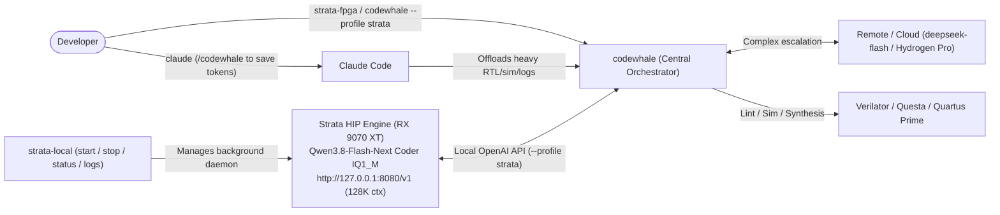

# 9070xtStrata — openFPGA + Intel Quartus Prime Workflow with Strata & Codewhale

Base setup, project rules, and workflow documentation for developing **openFPGA** cores (Analogue Pocket / Intel Cyclone V) assisted by agents via **`codewhale`** using **Strata** (`Qwen3.8-Flash-Next Coder IQ1_M`) on an **AMD Radeon RX 9070 XT (16 GB VRAM, native ROCm/HIP engine)** running on **Arch Linux**, with optional cloud escalation for complex architecture design and timing closure.

---

## Repository Structure

```text
.
├── .gitignore                  # Quartus artifacts, simulation files (Verilator/Questa), and local configs
├── AGENTS.md                   # Model routing rules and strict Cyclone V synthesis guidelines
├── CLAUDE.md                   # Claude Code rules for offloading heavy tasks to codewhale (token saving)
├── README.md                   # Environment, lifecycle scripts, and workflow guide with Strata & Codewhale
└── docs/
    └── ai-fpga-workflow.md     # Hybrid workflow diagrams and hardware resource allocation
```

---

## Architecture: Strata (`local-fpga`) & Orchestration with `codewhale`

In this setup, **Strata** (`0.1.61` with native HIP engine `0.1.60` for `gfx1201`) runs **`Qwen3.8-Flash-Next Coder (IQ1_M)`** locally—keeping half the experts specialized in code, tool calling, and images (~32 GB RAM + 16 GB VRAM, leaving ~32 GB of system RAM free for Quartus Prime builds) and exposing an OpenAI-compatible API on `http://127.0.0.1:8080/v1` (128K context).

**`codewhale`** acts as the **central orchestrator** using `--profile strata`: it reads [`AGENTS.md`](./AGENTS.md), routes local tasks to Strata and complex tasks to remote/cloud models, edits files, and runs Verilator/Questa and Quartus Prime.



### Tasks Assigned to Strata (`--profile strata`)

As defined in [`AGENTS.md`](./AGENTS.md):

- Generation and maintenance of **testbenches** (SystemVerilog / VHDL) and scripts for Verilator or Questa.
- **Auxiliary modules:** counters, frequency dividers, shift registers, LUT tables (`.mif` / `.hex`), and controller mapping (`cont1_key`).
- **Quick fixes for Quartus warnings** (`width mismatch`, unconnected signals, register inference).
- Automation scripts (`Makefile`, `build.sh`, `.rbf` packaging).

### Escalation to Cloud / Remote

Higher complexity tasks are escalated to cloud/remote models:

- **RTL architecture** design, video/audio pipelines, SDRAM/CRAM controllers, and bus decoding.
- **Clock Domain Crossing (CDC):** asynchronous FIFOs (`dcfifo`) and multi-stage synchronizers between system clocks and `video_rgb_clock`.
- **openFPGA** platform configuration (`core.json`, `video.json`, `data.json`, `interact.json`), pinouts (`.qsf`), and **TimeQuest** constraints (`.sdc`).
- In-depth analysis of `.sta.rpt` and `.fit.rpt` reports for *Timing Closure* resolution.

---

## Local Lifecycle & Usage (`strata-local` & `strata-fpga`)

Local service management is handled via `~/.local/bin/strata-local` and `~/.local/bin/strata-fpga` (`codewhale-strata`):

```bash
# Start Strata in the background (port 8080, family: coder, model: iq1_m, context: 128k)
strata-local start       # Aliases: subir, up

# Stop Strata and free GPU VRAM
strata-local stop        # Aliases: bajar, down

# Check service status, endpoint, PID, and RX 9070 XT VRAM usage
strata-local status      # Alias: estado

# Watch download / inference logs in real time
strata-local logs

# Launch Codewhale directly against local Strata (--profile strata)
strata-fpga
```

---

## Hardware and Target Environment

| Component | Specification | Role |
| :--- | :--- | :--- |
| **GPU** | AMD Radeon RX 9070 XT (16 GB VRAM) | Local inference with **Strata** (`0.1.60-linux-x86_64-hip-rx9070`, `Qwen3.8-Flash-Next Coder IQ1_M`) |
| **CPU** | Intel i7-14700KF / i9-14900K | RTL simulation (Verilator / Questa) and Quartus Place & Route |
| **RAM** | 64 GB DDR5 | ~32 GB for `Coder IQ1_M` experts + ~32 GB free for Cyclone V Quartus compilation |
| **OS** | Arch Linux | Development, simulation, and synthesis environment |
| **Target FPGA** | Intel Cyclone V (`5CEBA4F23C8` / `5CEFA7F27C8`) | Synthesis and `.rbf` bitstream generation for openFPGA |

---

## Synthesis Rules and Validation

All RTL code generated or modified in projects following this workflow must comply with the rules in [`AGENTS.md`](./AGENTS.md):

1. **Intel Cyclone V primitives only** (`altpll`, `altsyncram`, `dcfifo` or clean RTL inference for `quartus_map`); strictly forbidden to use Xilinx/Vivado primitives.
2. **Zero latches** in combinational blocks (`always_comb` / `process`).
3. **Standard openFPGA `core_top` interface** (`bridge_*`, `video_rgb`, `video_hs`, `video_vs`, `video_de`, `video_skip`, `audio_l`, `audio_r`).
4. **Validation before committing RTL changes:**

```bash
# Fast lint check with Verilator
verilator --lint-only -Wall <top_file>.sv

# Full compilation with Intel Quartus Prime
quartus_sh --flow compile <project>.qpf
```

For more details on the complete pipeline and workflow diagrams, see [`docs/ai-fpga-workflow.md`](./docs/ai-fpga-workflow.md).
