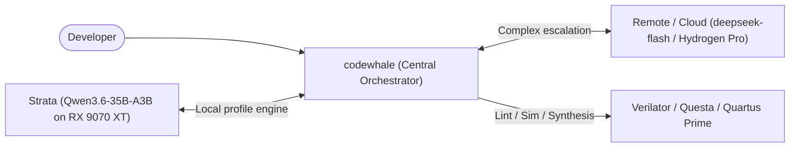

# 9070xtStrata — openFPGA + Intel Quartus Prime Workflow with Strata & Codewhale

Base setup, project rules, and workflow documentation for developing **openFPGA** cores (Analogue Pocket / Intel Cyclone V) assisted by agents via **`codewhale`** using **Strata** (`Qwen3.6-35B-A3B`) on an **AMD Radeon RX 9070 XT (16 GB VRAM)** running on **Arch Linux**, with optional cloud escalation for complex architecture design and timing closure.

---

## Repository Structure

```text
.
├── .gitignore                  # Quartus artifacts, simulation files (Verilator/Questa), and local configs
├── AGENTS.md                   # Model routing rules and strict Cyclone V synthesis guidelines
├── README.md                   # Environment and workflow guide with Strata & Codewhale
└── docs/
    └── ai-fpga-workflow.md     # Hybrid workflow diagrams and hardware resource allocation
```

---

## Usage with Strata (`local-fpga`) and Orchestration with `codewhale`

In this workflow, **Strata** runs the `Qwen3.6-35B-A3B` model locally leveraging the **16 GB VRAM** of the **RX 9070 XT** (and offloading excess MoE layers to the system's **64 GB DDR5** when needed). **`codewhale`** acts as the **central orchestrator** of the project: it reads [`AGENTS.md`](./AGENTS.md), routes tasks between local Strata and cloud/remote models, edits files, and executes Verilator/Questa and Quartus Prime.



### Tasks Assigned to Strata (`local-fpga`)

As defined in [`AGENTS.md`](./AGENTS.md):

- Generation and maintenance of **testbenches** (SystemVerilog / VHDL) and scripts for Verilator or Questa.
- **Auxiliary modules:** counters, frequency dividers, shift registers, LUT tables (`.mif` / `.hex`), and controller mapping (`cont1_key`).
- **Quick fixes for Quartus warnings** (`width mismatch`, unconnected signals, register inference).
- Automation scripts (`Makefile`, `build.sh`, `.rbf` packaging).

### Escalation to Cloud / Remote

Higher complexity tasks are escalated to cloud/remote models:

- **RTL architecture** design, video/audio pipelines, SDRAM/CRAM controllers, and bus decoding.
- **Clock Domain Crossing (CDC):** asynchronous FIFOs (`dcfifo`) and multi-stage synchronizers between system clocks and `video_rgb_clock`.
- **openFPGA** platform configuration (`core.json`, `video.json`, `data.json`, `interact.json`), pinouts (`.qsf`), and **TimeQuest** constraints (`.sdc`).
- In-depth analysis of `.sta.rpt` and `.fit.rpt` reports for *Timing Closure* resolution.

---

## Hardware and Target Environment

| Component | Specification | Role |
| :--- | :--- | :--- |
| **GPU** | AMD Radeon RX 9070 XT (16 GB VRAM) | Local inference with **Strata** (`Qwen3.6-35B-A3B`, ~14–15 GB VRAM) |
| **CPU** | Intel i7-14700KF (20 cores) | RTL simulation (Verilator / Questa) and Quartus Place & Route |
| **RAM** | 64 GB DDR5 | Cyclone V compilation (~12–16 GB) + Strata MoE layer offload |
| **OS** | Arch Linux | Development, simulation, and synthesis environment |
| **Target FPGA** | Intel Cyclone V (`5CEBA4F23C8` / `5CEFA7F27C8`) | Synthesis and `.rbf` bitstream generation for openFPGA |

---

## Synthesis Rules and Validation

All RTL code generated or modified in projects following this workflow must comply with the rules in [`AGENTS.md`](./AGENTS.md):

1. **Intel Cyclone V primitives only** (`altpll`, `altsyncram`, `dcfifo` or clean RTL inference for `quartus_map`); strictly forbidden to use Xilinx/Vivado primitives.
2. **Zero latches** in combinational blocks (`always_comb` / `process`).
3. **Standard openFPGA `core_top` interface** (`bridge_*`, `video_rgb`, `video_hs`, `video_vs`, `video_de`, `video_skip`, `audio_l`, `audio_r`).
4. **Validation before committing RTL changes:**

```bash
# Fast lint check with Verilator
verilator --lint-only -Wall <top_file>.sv

# Full compilation with Intel Quartus Prime
quartus_sh --flow compile <project>.qpf
```

For more details on the complete pipeline and workflow diagrams, see [`docs/ai-fpga-workflow.md`](./docs/ai-fpga-workflow.md).
