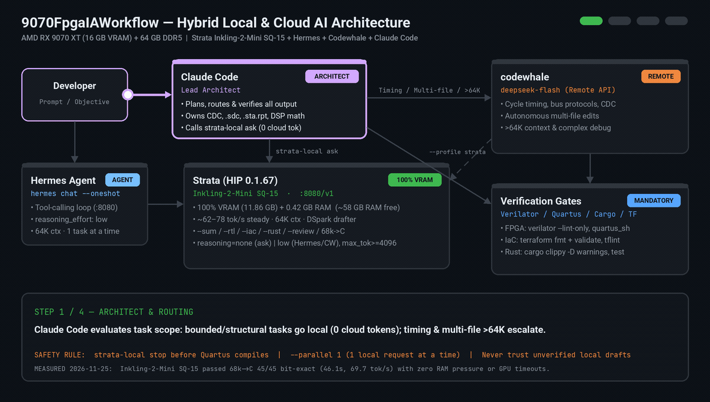
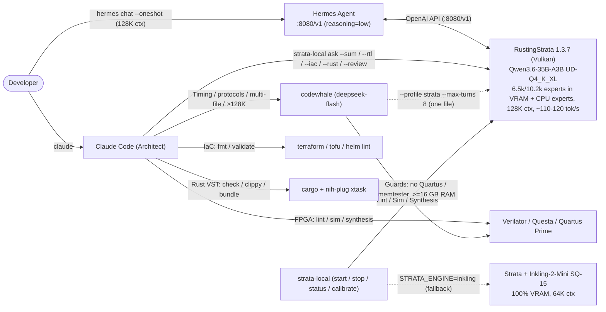

# 9070FpgaIAWorkflow — Hybrid Local & Cloud AI Workflow (RX 9070 XT 16 GB)

Base setup, project rules, and workflow documentation for developing **openFPGA** cores (Analogue Pocket / Intel Cyclone V), **DevOps/IaC** (Terraform/OpenTofu, Kubernetes/Helm, Ansible), and **Rust VST3/CLAP** audio plugins (`nih-plug`) using **Claude Code** and **Hermes Agent** assisted by a local GPU minion (**[RustingStrata](https://github.com/RustingStudio/RustingStrata)** serving **`Qwen3.6-35B-A3B UD-Q4_K_XL`** on the **AMD Radeon RX 9070 XT 16 GB** over Vulkan) and **`codewhale`** (`deepseek-flash`) for autonomous multi-file edits and >128K context escalation on **Arch Linux**.

> **2026-11-26 — engine switch:** the local minion moved from Strata (Niko1221) + `Inkling-2-Mini SQ-15` to **RustingStrata 1.3.7 + `Qwen3.6-35B-A3B`** after a same-method A/B on this machine ([table below](#benchmark-rustingstrata-vs-strata-on-the-rx-9070-xt)). Inkling stays installed as a fallback: `STRATA_ENGINE=inkling strata-local start`.

---

## Repository Structure

```text
.
├── .gitignore                  # Quartus artifacts, simulation files (Verilator/Questa), and local configs
├── AGENTS.md                   # Model routing rules and strict Cyclone V synthesis guidelines
├── CLAUDE.md                   # Claude Code rules for offloading bounded work to the local minion / codewhale
├── README.md                   # Environment, lifecycle scripts, benchmark, and workflow guide
├── scripts/
│   ├── strata-local            # Local minion lifecycle + `ask` CLI, engines rusting|inkling (install to ~/.local/bin)
│   ├── apibench.py             # Same-method A/B benchmark for any OpenAI-compatible local server
│   └── make_workflow_gif.py    # Regenerates docs/assets/strata-hybrid-workflow.gif (Pillow + ffmpeg)
├── skills/
│   └── hybrid-local-ai/        # Claude Code skill: hybrid routing for FPGA, DevOps/IaC and Rust VST (install to ~/.claude/skills)
└── docs/
    ├── ai-fpga-workflow.md     # Hybrid workflow diagrams and hardware resource allocation
    └── assets/strata-hybrid-workflow.gif
```

---

## Architecture: RustingStrata (`Qwen3.6-35B-A3B`) + Hermes Agent + Claude Code + `codewhale`

**[RustingStrata](https://github.com/RustingStudio/RustingStrata)** `1.3.7` (pure-Rust GGUF engine, Vulkan backend, RADV Mesa 26.2) serves **`Qwen3.6-35B-A3B-UD-Q4_K_XL.gguf`** (35B MoE / 3B active, 22.4 GB) with **128K context** (KV cache `q8`; the model is trained for 262K) on `http://127.0.0.1:8080/v1` (alias `qwen3.6-35b-a3b`). About **6.5k of 10.2k experts live in the 16 GB VRAM** next to a 1.36 GB q8 KV cache for 128K tokens; the rest run on the CPU at the same time. The process itself uses **~0.2 GB of RAM**; the GGUF sits in the **page cache (~21 GB, reclaimable)**. Calibrated on this card at 128K/q8: chunk 2048, no MTP, **~110–120 tok/s decode** on everyday prompts, ~81 tok/s after a 120K-token prompt.

- **`strata-local ask`** ([`scripts/strata-local`](./scripts/strata-local)): Direct `stdin`/file CLI minion for Claude Code (`--sum`, `--rtl`, `--iac`, `--rust`, `--review`). Thinking off by default (`enable_thinking=false`); `--think` opts in.
- **Hermes Agent** (`/usr/bin/hermes`): Local tool-calling agent on `http://127.0.0.1:8080/v1` (`qwen3.6-35b-a3b`, `128K` ctx, `agent.reasoning_effort: low`) for single-file / bounded tasks (`hermes chat -q "..." --oneshot`).
- **`codewhale`** (default `deepseek-flash`): Autonomous multi-file orchestrator for timing/protocol reasoning, testbench checking logic, or >128K context. Profile `strata` (`--profile strata --max-turns 8`) targets the local endpoint for single-file tasks.
- **Claude Code**: Lead architect that delegates bounded reading, summaries, structural RTL inventory, and boilerplate to the local minion, escalates timing/cycle-level or multi-file work to `codewhale`, makes final diagnoses, and verifies against code and simulations (`verilator --lint-only`, `iverilog`, `quartus_sh`, `terraform validate`, `cargo clippy`).





---

## Benchmark: RustingStrata vs Strata on the RX 9070 XT

Measured 2026-11-26 on this machine (RX 9070 XT, RADV Mesa 26.2.7, 64 GB DDR5), same client script ([`scripts/apibench.py`](./scripts/apibench.py)), same prompts, greedy, 256 reply tokens, thinking off. "Short" is a 33–38-token RTL request; "long" is ~7.3–7.9k tokens of this repo's code (token counts differ by tokenizer). RustingStrata values are run 1 → run 3, because expert placement adapts to the routing it sees.

| Measured | Strata 0.2.21 + `Inkling-2-Mini SQ-15` (before) | **RustingStrata 1.3.7 Vulkan + `Qwen3.6-35B-A3B` (now)** | RustingStrata 1.3.7 HIP (experimental) |
| --- | --- | --- | --- |
| Decode, short prompt | 69–73 tok/s | **92 → 107 → 129 tok/s** | 107 → 113 → 122 tok/s |
| Prefill, ~7.5k-token prompt (cold) | ~1430 tok/s | ~1450 tok/s | **~2000 tok/s** |
| Decode after that prompt | ~51 tok/s | **99 → 122 → 114 tok/s** | 106 → 115 → 116 tok/s |
| Same long prompt again | re-prefilled (5.5 s) | **prompt cache hit (0.12 s)** | prompt cache hit (0.11 s) |
| `calibrate` best point | — | chunk 1024, MTP 0: 131 tok/s decode | chunk 2048, MTP 0: 119 tok/s decode |
| Context during this A/B | 64K | 32K (KV f16, 640 MB) | 32K |
| Placement / memory | 100% VRAM, ~0.4 GB RAM | ~6.7–6.9k/10.2k experts in VRAM; ~0.2 GB RAM + ~21 GB page cache (reclaimable) | same |
| Stability (3 runs + calibration) | stable | no GPU resets, no CPU-worker stalls, clean `dmesg` | same |
| Extra dependencies | — | none (single binary) | `libhiprtc`/`libamdhip64` + HIP headers (borrowed from a PyTorch-ROCm/Triton venv) |

**Verdict:** RustingStrata on Vulkan decodes **~1.5–2.4× faster** with a larger model and caches repeated prompts; HIP only wins cold prefill and depends on borrowed ROCm libraries, so Vulkan is the default (`RS_BACKEND=hip` to try HIP). Trade-off: if Quartus pushes the GGUF out of the page cache the CPU-side experts are re-read from disk — stopping the minion before compiles stays the rule.

### Context size: 32K → 128K

After the switch the context was raised to **128K with a q8 KV cache** (default in `strata-local`). Qwen3.6-35B-A3B is trained for 262K and only 1 in 4 layers keeps a full-attention KV cache, so 128K q8 costs 1.36 GB of VRAM. `rustingstrata bench`, Vulkan, 128 reply tokens (128K rows: one run each):

| `--ctx` / `--kv` | KV in VRAM | Experts in VRAM | 8K prompt: prefill / decode | Deep prompt: prefill / decode |
| --- | --- | --- | --- | --- |
| 32K f16 (first setup) | 640 MB | 6930 | 2544 / 121 tok/s | — |
| 64K f16 | 1280 MB | 6580 | 2402 / 116 tok/s | — |
| 64K q8 | 680 MB | 6909 | 2483 / 119 tok/s | 60K: 1620 / 103 tok/s |
| **128K q8 (now)** | 1360 MB | 6539 | 1893 / 109 tok/s | **120K: 1055 / 81 tok/s** |
| 128K f16 | 2560 MB | 5880 | 1652 / 101 tok/s | 120K: 1069 / 73 tok/s |

Through the API (`scripts/apibench.py`) at 128K q8, after `strata-local calibrate` (chunk 2048, MTP 0): short-prompt decode 85 → 95 → 119 tok/s, ~7.3k-token prompt prefill ~1580 tok/s and decode 89 → 112 → 114 tok/s. Everyday prompts lose ~10% against 32K; in exchange, logs and multi-file RTL up to 128K stay local (a 120K-token prompt takes ~2 min to prefill). No amdgpu resets or btrfs errors during the deep runs.

---

### Tasks Assigned to the Local Minion

As defined in [`AGENTS.md`](./AGENTS.md) and [`CLAUDE.md`](./CLAUDE.md), the local minion is restricted to **bounded / structural work**:

- **Summaries & logs:** summarizing large files, diffs, or Quartus/Verilator build logs (`strata-local ask --sum -f ...`).
- **RTL reading & structural auditing:** summarizing ports, parameters, clock/reset domains, FSM state lists, module dependencies, and lint-style checks (`strata-local ask --rtl -f ...`).
- **Boilerplate & auxiliary modules:** counters, frequency dividers, shift registers, IaC modules (`--iac`), and `nih-plug` boilerplate (`--rust -f src/params.rs`).
- **First-pass code reviews:** reviewing a complete function or file (`strata-local ask --review -f ...`), with every finding confirmed by Claude Code.

> [!IMPORTANT]
> **Timing & Protocol Boundary:** Do **not** use local models for timing, cycle-by-cycle behaviour of registered logic, clock/phase reasoning, or bus protocols. All timing/protocol reasoning routes to `codewhale` (`deepseek-flash`) or Claude Code.

### Escalation to Remote (`codewhale` `deepseek-flash` / Claude Code)

Higher complexity tasks and all timing-sensitive delegable work stay in Claude Code or escalate to `codewhale` (`deepseek-flash`):

- **Timing & protocol reasoning:** cycle-by-cycle analysis of registered logic, protocol/waveform reasoning, and testbench checking logic.
- **Autonomous audits & multi-file edits:** `codewhale exec --auto --sandbox read-only` / `--sandbox workspace-write` (and `--resume <SESSION_ID>`), or anything above 128K tokens.
- **RTL architecture** design, video/audio pipelines, SDRAM/CRAM controllers, and bus decoding.
- **Clock Domain Crossing (CDC):** asynchronous FIFOs (`dcfifo`) and multi-stage synchronizers between system clocks and `video_rgb_clock`.
- **openFPGA** platform configuration (`core.json`, `video.json`, `data.json`, `interact.json`), pinouts (`.qsf`), and **TimeQuest** constraints (`.sdc`).
- In-depth analysis of `.sta.rpt` and `.fit.rpt` reports for *Timing Closure* resolution.

---

## Local Minion (`strata-local`) & Usage

**Active configuration:**

| Setting | Value | Notes |
| --- | --- | --- |
| **Engine** | `rustingstrata 1.3.7` (`STRATA_ENGINE=rusting`, `RS_BACKEND=vulkan`) | Binary in `~/.local/opt/rustingstrata/`, symlinked as `~/.local/bin/rustingstrata` |
| **Model** | `~/models/gguf/Qwen3.6-35B-A3B-UD-Q4_K_XL.gguf` (alias `qwen3.6-35b-a3b`) | Calibration in `~/.cache/rusting_strata/strata-Qwen3.6-35B-A3B-UD-Q4_K_XL-vulkan.json` |
| **Endpoint / Context** | `http://127.0.0.1:8080/v1` · `128K` (`131072`, KV `q8`) · `--parallel 1` | Log: `~/.local/state/rustingstrata/serve.log` |
| **Thinking / Tokens** | off (`strata-local ask`), `reasoning_effort: low` (Hermes / `codewhale --profile strata`) | `max_tokens >= 4096`; `--think` opts in on `ask` |
| **Fallback** | `STRATA_ENGINE=inkling` → Strata `daily` preset, `Inkling-2-Mini SQ-15`, 64K ctx | `codewhale --profile inkling`, Hermes needs `model.default: inkling-2-mini-sq-15` |

```bash
# Install (user space) and wire up
mkdir -p ~/.local/opt/rustingstrata ~/models/gguf
gh release download -R RustingStudio/RustingStrata -p rustingstrata-linux-x86_64 -D ~/.local/opt/rustingstrata
chmod +x ~/.local/opt/rustingstrata/rustingstrata-linux-x86_64
ln -sfn ~/.local/opt/rustingstrata/rustingstrata-linux-x86_64 ~/.local/bin/rustingstrata
curl -L -o ~/models/gguf/Qwen3.6-35B-A3B-UD-Q4_K_XL.gguf \
  https://huggingface.co/unsloth/Qwen3.6-35B-A3B-GGUF/resolve/main/Qwen3.6-35B-A3B-UD-Q4_K_XL.gguf
install -m755 scripts/strata-local ~/.local/bin/ && cp -r skills/hybrid-local-ai ~/.claude/skills/

strata-local calibrate   # once per model/backend, server stopped (~5 min)
strata-local plan        # engine, model, backend, ctx and calibration; nothing changes
strata-local start       # RustingStrata Vulkan on :8080 (STRATA_ENGINE=inkling for the fallback)
strata-local ask --sum  -f build.log "summarize errors and timing slack"
strata-local ask --iac  "Terraform: GCS bucket with lifecycle and FinOps labels"
strata-local ask --rust -f src/lib.rs "add a bypass BoolParam"
strata-local ask --rtl  -f rtl/core_top.sv
strata-local stop        # stop before Quartus compiles

# Reproduce the benchmark against whatever is on :8080
python3 -I scripts/apibench.py http://127.0.0.1:8080 qwen3.6-35b-a3b <~24KB-code-file> 256
```

### Agent Invocation (`hermes` & `codewhale`)

```bash
# Hermes (local :8080, one-shot, single routine / bounded prompt)
hermes chat -q "<focused prompt>" --oneshot --in /path/to/repo

# codewhale local profile (one file, bounded turns)
codewhale --profile strata exec --auto --max-turns 8 "<one file, one question>"

# codewhale remote (deepseek-flash — timing, multi-file, >128K ctx)
codewhale exec --auto --sandbox read-only "<focused prompt with file paths/line ranges>"
codewhale exec --auto --sandbox workspace-write "<focused prompt with verification criteria>"
codewhale exec --resume <SESSION_ID> --auto --sandbox workspace-write "<follow-up>"
```

> [!WARNING]
> **Safety & Operational Notes:**
> - `strata-local start` refuses to run while `memtester` or Quartus run or with <16 GB RAM available. Stop the minion (`strata-local stop`) before running `quartus_sh`.
> - RustingStrata on AMD is community-tested: if `strata-local logs` shows `timed out and resumed` waits by the hundreds, NaN logits, or `dmesg` shows an amdgpu reset, switch to `STRATA_ENGINE=inkling` and report it upstream ([docs/AMD.md](https://github.com/RustingStudio/RustingStrata/blob/main/docs/AMD.md)).
> - Inkling fallback: never combine `--tune` with other option changes; tune on an idle machine.
> - Do **not** run `pkill -f 'codewhale ...'`, `pkill -f strata` or `pkill -f rustingstrata` from Bash — the pattern matches the shell itself and terminates it (exit 144). `strata-local stop` kills by PID.

---

## Hardware and Target Environment

| Component | Specification | Role |
| :--- | :--- | :--- |
| **GPU** | AMD Radeon RX 9070 XT (16 GB VRAM) | Local inference: **RustingStrata** (`Qwen3.6-35B-A3B`, Vulkan, ~6.5k/10.2k experts in VRAM) |
| **CPU** | Intel i7-14700KF / i9-14900K | CPU-side MoE experts while the minion runs; RTL simulation and Quartus Place & Route |
| **RAM** | 64 GB DDR5 | Quartus/simulation; minion uses ~0.2 GB + ~21 GB reclaimable page cache (still stop it before Quartus) |
| **OS** | Arch Linux | Development, simulation, and synthesis environment |
| **Target FPGA** | Intel Cyclone V (`5CEBA4F23C8` / `5CEFA7F27C8`) | Synthesis and `.rbf` bitstream generation for openFPGA |

---

## Synthesis Rules and Validation

All RTL code generated or modified in projects following this workflow must comply with the rules in [`AGENTS.md`](./AGENTS.md):

1. **Intel Cyclone V primitives only** (`altpll`, `altsyncram`, `dcfifo` or clean RTL inference for `quartus_map`); strictly forbidden to use Xilinx/Vivado primitives.
2. **Zero latches** in combinational blocks (`always_comb` / `process`).
3. **Standard openFPGA `core_top` interface** (`bridge_*`, `video_rgb`, `video_hs`, `video_vs`, `video_de`, `video_skip`, `audio_l`, `audio_r`).
4. **Validation before committing RTL changes:**

```bash
# Fast lint check with Verilator
verilator --lint-only -Wall <top_file>.sv

# Full compilation with Intel Quartus Prime
quartus_sh --flow compile <project>.qpf
```

For more details on the complete pipeline and workflow diagrams, see [`docs/ai-fpga-workflow.md`](./docs/ai-fpga-workflow.md).
