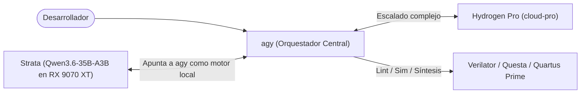

# 9070xtStrata — Flujo openFPGA + Intel Quartus Prime con Strata

Configuración base, reglas de proyecto y documentación de flujo de trabajo para desarrollar cores **openFPGA** (Analogue Pocket / Intel Cyclone V) asistido por agentes (`agy` / Antigravity) usando **Strata** (`Qwen3.6-35B-A3B`) en **AMD Radeon RX 9070 XT (16 GB VRAM)** sobre **Arch Linux**, con escalado opcional a **Hydrogen Pro** para tareas de arquitectura y cierre de timing.

---

## Estructura del Repositorio

```text
.
├── .gitignore                  # Artefactos de Quartus, simulación (Verilator/Questa) y archivos locales
├── AGENTS.md                   # Reglas de enrutamiento de modelos y síntesis estricta para Cyclone V
├── README.md                   # Guía de uso del entorno con Strata
└── docs/
    └── ai-fpga-workflow.md     # Diagrama de flujo híbrido y distribución de recursos de hardware
```

---

## Uso con Strata (`local-fpga`) y Orquestación con `agy`

En este flujo, **Strata** ejecuta el modelo `Qwen3.6-35B-A3B` de forma local aprovechando los **16 GB de VRAM** de la **RX 9070 XT** (y offload de capas MoE excedentes a los **64 GB DDR5** del sistema cuando es necesario) y **apunta hacia `agy`**, que actúa como **orquestador central** del proyecto: lee [`AGENTS.md`](./AGENTS.md), decide qué tareas van a Strata o a `cloud-pro`, edita archivos y ejecuta Verilator/Questa y Quartus Prime.



### Tareas asignadas a Strata (`local-fpga`)

Según lo definido en [`AGENTS.md`](./AGENTS.md):

- Generación y mantenimiento de **testbenches** (SystemVerilog / VHDL) y scripts para Verilator o Questa.
- **Módulos auxiliares:** contadores, divisores de frecuencia, registros de desplazamiento, tablas LUT (`.mif` / `.hex`) y mapeo de controles (`cont1_key`).
- **Corrección rápida de warnings** de Quartus (`width mismatch`, señales sin conectar, inferencia de registros).
- Scripts de automatización (`Makefile`, `build.sh`, empaquetado de `.rbf`).

### Escalado a `cloud-pro` (Hydrogen Pro)

Las tareas de mayor complejidad se escalan a `cloud-pro`:

- Diseño de **arquitectura RTL**, pipelines de vídeo/audio, controladores SDRAM/CRAM y decodificación de buses.
- **Cruces de dominio de reloj (CDC):** FIFOs asíncronos (`dcfifo`) y sincronizadores multi-etapa entre relojes de sistema y `video_rgb_clock`.
- Configuración de plataforma **openFPGA** (`core.json`, `video.json`, `data.json`, `interact.json`), pines (`.qsf`) y restricciones **TimeQuest** (`.sdc`).
- Diagnóstico profundo de reportes `.sta.rpt` y `.fit.rpt` para resolución de *Timing Closure*.

---

## Hardware y Entorno Objetivo

| Componente | Especificación | Rol |
| :--- | :--- | :--- |
| **GPU** | AMD Radeon RX 9070 XT (16 GB VRAM) | Inferencia local con **Strata** (`Qwen3.6-35B-A3B`, ~14–15 GB VRAM) |
| **CPU** | Intel i7-14700KF (20 cores) | Simulación RTL (Verilator / Questa) y Place & Route de Quartus |
| **RAM** | 64 GB DDR5 | Compilación Cyclone V (~12–16 GB) + offload de capas MoE de Strata |
| **OS** | Arch Linux | Entorno de desarrollo, simulación y síntesis |
| **FPGA Target** | Intel Cyclone V (`5CEBA4F23C8` / `5CEFA7F27C8`) | Síntesis y generación de bitstream `.rbf` para openFPGA |

---

## Reglas de Síntesis y Validación

Todo código RTL generado o modificado en proyectos que adopten este flujo debe cumplir las reglas de [`AGENTS.md`](./AGENTS.md):

1. **Solo primitivas Intel Cyclone V** (`altpll`, `altsyncram`, `dcfifo` o inferencia RTL limpia para `quartus_map`); prohibido usar primitivas Xilinx/Vivado.
2. **Cero latches** en bloques combinacionales (`always_comb` / `process`).
3. **Interfaz estándar `core_top` de openFPGA** (`bridge_*`, `video_rgb`, `video_hs`, `video_vs`, `video_de`, `video_skip`, `audio_l`, `audio_r`).
4. **Validación antes de cerrar cambios RTL:**

```bash
# Verificación rápida de lint con Verilator
verilator --lint-only -Wall <archivo_top>.sv

# Compilación completa con Intel Quartus Prime
quartus_sh --flow compile <proyecto>.qpf
```

Para más detalles sobre el pipeline completo y el diagrama de flujo, consulta [`docs/ai-fpga-workflow.md`](./docs/ai-fpga-workflow.md).
