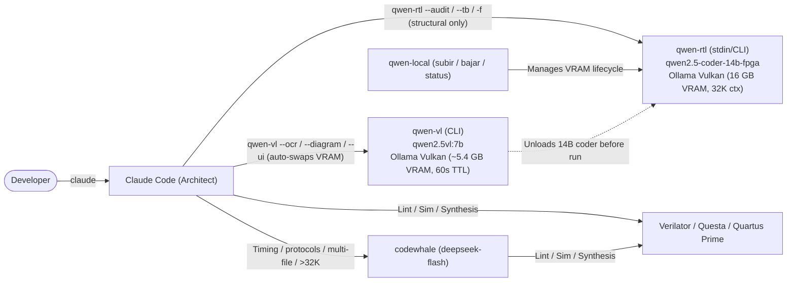

# 9070FpgaIAWorkflow — openFPGA + Intel Quartus Prime Workflow with Local Qwen 14B (Ollama Vulkan), Claude Code & Codewhale

Base setup, project rules, and workflow documentation for developing **openFPGA** cores (Analogue Pocket / Intel Cyclone V) using **Claude Code** assisted by a local GPU minion (**`qwen-rtl`** running **`qwen2.5-coder-14b-fpga`** on **Ollama Vulkan** / **AMD Radeon RX 9070 XT 16 GB VRAM**) and **`codewhale`** (`deepseek-flash`) for autonomous multi-file edits and >32k context escalation on **Arch Linux**.

---

## Repository Structure

```text
.
├── .gitignore                  # Quartus artifacts, simulation files (Verilator/Questa), and local configs
├── AGENTS.md                   # Model routing rules and strict Cyclone V synthesis guidelines
├── CLAUDE.md                   # Claude Code rules for offloading RTL reading & testbenches to qwen-rtl / codewhale
├── README.md                   # Environment, lifecycle scripts, and workflow guide
├── scripts/
│   └── strata-local            # Strata lifecycle + `ask` minion (install to ~/.local/bin)
├── skills/
│   └── hybrid-local-ai/        # Claude Code skill: hybrid routing for FPGA, DevOps/IaC and Rust VST (install to ~/.claude/skills)
└── docs/
    └── ai-fpga-workflow.md     # Hybrid workflow diagrams and hardware resource allocation
```

---

## Architecture: Local `qwen-rtl` (Ollama Vulkan) + Claude Code + `codewhale`

In this setup, **Ollama Vulkan** runs **`qwen2.5-coder-14b-fpga`** (`hf.co/bartowski/Qwen2.5-Coder-14B-Instruct-GGUF:Q5_K_M`, ~10.5 GB weights + ~5.5 GB KV cache for **32K context**) **100% inside the RX 9070 XT's 16 GB VRAM** with zero system RAM spill—leaving all ~62 GB of DDR5 RAM free for Quartus Prime and Verilator/Questa.

- **`qwen-rtl`** (`~/.local/bin/qwen-rtl`): Direct `stdin`/CLI minion for Claude Code and the developer (`http://127.0.0.1:11434/api/chat`). Used **only** for structural/inventory audits, boilerplate, and testbench skeletons without tool-calling overhead.
- **`qwen-vl`** (`~/.local/bin/qwen-vl`): Local vision minion (`qwen2.5vl:7b`, ~6 GB VRAM) for OCR of Quartus/Verilator screenshots, pinout tables, block diagrams, and UI captures. Automatically unloads `qwen2.5-coder-14b-fpga` before running and expires after `60s` (`--restore` reloads the 14B coder).
- **`codewhale`** (default `deepseek-flash`): Autonomous multi-file orchestrator when timing/protocol reasoning, testbench checking logic, tool-calling (`read`/`edit`/`bash`), or >32K context is needed.
- **Claude Code**: Lead architect that delegates structural RTL reading and testbench skeletons to `qwen-rtl`, escalates timing/cycle-level or multi-file work to `codewhale`, makes final diagnoses, and verifies against code and simulations (`verilator --lint-only`, `iverilog`, `quartus_sh`).



### Tasks Assigned to Local `qwen-rtl` (`qwen2.5-coder-14b-fpga`)

As defined in [`AGENTS.md`](./AGENTS.md) and [`CLAUDE.md`](./CLAUDE.md), `qwen-rtl` is restricted to **structural / inventory work**:

- **RTL reading & structural auditing:** summarizing ports, parameters, clock/reset domains, FSM state lists, module dependencies, and lint-style checks (`qwen-rtl --audit -f ...`).
- **Testbench skeletons & boilerplate:** SystemVerilog/Verilog (`qwen-rtl --tb -f ...`) and `cocotb` (`qwen-rtl --cocotb -f ...`); Claude or `codewhale` fills in timing-dependent checks.
- **Auxiliary modules & boilerplate:** counters, frequency dividers, shift registers, LUT tables (`.mif` / `.hex`), and controller mapping (`cont1_key`).
- **Quick fixes for Quartus warnings** (`width mismatch`, unconnected signals, register inference) and build scripts (`Makefile`, `build.sh`, `.rbf` packaging).

> [!IMPORTANT]
> **Timing & Protocol Boundary:** Do **not** use Qwen for timing, cycle-by-cycle behaviour of registered logic, clock/phase reasoning, or bus protocols. Measured 2026-11-17 on `psk_sram.sv`: Qwen's structural inventory was accurate, but its cycle trace was wrong (it ignored the one-clock register delay and invented `OE#`/bus contention).

### Escalation to Remote (`codewhale` `deepseek-flash` / Claude Code)

Higher complexity tasks and all timing-sensitive delegable work stay in Claude Code or escalate to `codewhale` (`deepseek-flash`):

- **Timing & protocol reasoning:** cycle-by-cycle analysis of registered logic, protocol/waveform reasoning, and testbench checking logic.
- **Autonomous audits & multi-file edits:** `codewhale exec --auto --sandbox read-only` / `--sandbox workspace-write` (and `--resume <SESSION_ID>`). Note: do **not** use `codewhale --profile qwen exec` (Ollama's Go template parser does not unwrap Qwen2.5-Coder's fenced JSON tool calls).
- **RTL architecture** design, video/audio pipelines, SDRAM/CRAM controllers, and bus decoding.
- **Clock Domain Crossing (CDC):** asynchronous FIFOs (`dcfifo`) and multi-stage synchronizers between system clocks and `video_rgb_clock`.
- **openFPGA** platform configuration (`core.json`, `video.json`, `data.json`, `interact.json`), pinouts (`.qsf`), and **TimeQuest** constraints (`.sdc`).
- In-depth analysis of `.sta.rpt` and `.fit.rpt` reports for *Timing Closure* resolution.

---

## Strata Daily Minion (Qwen3.6-35B-A3B) — FPGA, DevOps/IaC and Rust VST

[Strata](https://github.com/Niko1221/Strata) serves **Qwen3.6-35B-A3B UD-Q4_K_XL** (Unsloth GGUF + MTP draft layer) on the RX 9070 XT in hybrid mode: hot experts in the 16 GB of VRAM, the rest in RAM, 32K context, OpenAI-compatible API on `http://127.0.0.1:8080/v1`. It is the default local minion for bounded work in every domain, wrapped by [`scripts/strata-local`](./scripts/strata-local).

**Why this model (2026-11-18):**

| Candidate in Strata | RAM for the model | Verdict for this box (16 GB VRAM, 64 GB RAM, Quartus) |
| --- | ---: | --- |
| **Qwen3.6-35B-A3B UD-Q4_K_XL** | ~32 GB plan, 22.9 GB file | **Chosen.** General + code (IaC, Rust, Spanish), MoE 3B active (fast decode), smallest download, leaves room for Quartus, Apache 2.0 |
| Qwen3.8-Flash-Next Coder IQ1_M | 23 GB experts + buffers | Code-only, weak outside code and in Spanish; wandered as an agent (2026-11-16) |
| Qwen3.8-Flash-Next IQ2_XS / IQ3_S | 39–55 GB | Better quality but leaves no RAM for Quartus/Verilator |
| Unsloth UD-IQ4_XS+ / NVFP4 | 72–136 GB | Do not fit / NVIDIA only |

```bash
# Install (user space, ~/.local) and wire up
curl -fsSL https://github.com/Niko1221/Strata/releases/latest/download/install.sh -o /tmp/strata-install.sh && sh /tmp/strata-install.sh
install -m755 scripts/strata-local ~/.local/bin/ && cp -r skills/hybrid-local-ai ~/.claude/skills/

strata-local plan     # what will be downloaded (~24 GB), nothing changes
strata-local start    # unloads Ollama, first run: --tune skip + saves preset "daily"
strata-local ask --iac  "Terraform: GCS bucket with lifecycle and FinOps labels"
strata-local ask --rust -f src/lib.rs "add a bypass BoolParam"
strata-local ask --rtl  -f rtl/core_top.sv
strata-local stop     # before Quartus, qwen-rtl or qwen-vl
```

`codewhale` profile `strata` (in `~/.codewhale/config.toml`) is only for one-file tasks with `--max-turns 8`.

> [!WARNING]
> **Safety:** Strata was retired on 2026-11-17 after a corrupted file on the OS btrfs and reinstalled on 2026-11-18. `strata-local start` refuses to run while `memtester` or Quartus run or with <24 GB RAM available. If corruption reappears (`dmesg | grep -i btrfs`, `btrfs scrub status /`), stop Strata. Never combine `--tune` with other option changes; tune on an idle machine.

---

## Local Lifecycle & Usage (`qwen-local` & `qwen-rtl`)

Local VRAM and inference management is handled via `~/.local/bin/qwen-local` and `~/.local/bin/qwen-rtl`:

```bash
# Preload qwen2.5-coder-14b-fpga into RX 9070 XT VRAM (keep_alive=-1)
qwen-local subir         # Aliases: up, start

# Unload from VRAM when done (frees ~16 GB VRAM)
qwen-local bajar         # Aliases: down, stop

# Check ollama service and loaded VRAM
qwen-local status        # Alias: estado

# Audit an RTL module (ports, params, clock/reset, FSM states, risks)
qwen-rtl --audit -f rtl/uart_tx.sv

# Generate a SystemVerilog/Verilog testbench skeleton
qwen-rtl --tb -f rtl/uart_tx.sv > tb/tb_uart_tx.sv

# Focused structural question or stdin pipe
qwen-rtl -f rtl/uart_tx.sv "List all FSM states and reset conditions"
cat rtl/fifo.v | qwen-rtl "Check for latch risks or async resets"
```

### Remote Escalation (`codewhale`)

```bash
# Read-only audit / timing & protocol analysis
codewhale exec --auto --sandbox read-only "<focused prompt with file paths/line ranges>"

# Autonomous workspace edits with verification criteria
codewhale exec --auto --sandbox workspace-write "<focused prompt with verification criteria>"

# Resume a previous session
codewhale exec --resume <SESSION_ID> --auto --sandbox workspace-write "<follow-up>"
```

> [!WARNING]
> **Operational Note:** Do **not** run `pkill -f 'codewhale ...'` from Bash — the pattern matches the shell itself and terminates it (exit 144). Always kill by PID.

---

## Hardware and Target Environment

| Component | Specification | Role |
| :--- | :--- | :--- |
| **GPU** | AMD Radeon RX 9070 XT (16 GB VRAM) | Local inference: **Strata** (Qwen3.6-35B-A3B, HIP, hybrid VRAM+RAM) or **Ollama Vulkan** (`qwen2.5-coder-14b-fpga`, 100% GPU) — exclusive |
| **CPU** | Intel i7-14700KF / i9-14900K | RTL simulation (Verilator / Questa) and Quartus Place & Route |
| **RAM** | 64 GB DDR5 | Quartus/simulation; Strata takes ~12–16 GB while running (stop it before Quartus) |
| **OS** | Arch Linux | Development, simulation, and synthesis environment |
| **Target FPGA** | Intel Cyclone V (`5CEBA4F23C8` / `5CEFA7F27C8`) | Synthesis and `.rbf` bitstream generation for openFPGA |

---

## Synthesis Rules and Validation

All RTL code generated or modified in projects following this workflow must comply with the rules in [`AGENTS.md`](./AGENTS.md):

1. **Intel Cyclone V primitives only** (`altpll`, `altsyncram`, `dcfifo` or clean RTL inference for `quartus_map`); strictly forbidden to use Xilinx/Vivado primitives.
2. **Zero latches** in combinational blocks (`always_comb` / `process`).
3. **Standard openFPGA `core_top` interface** (`bridge_*`, `video_rgb`, `video_hs`, `video_vs`, `video_de`, `video_skip`, `audio_l`, `audio_r`).
4. **Validation before committing RTL changes:**

```bash
# Fast lint check with Verilator
verilator --lint-only -Wall <top_file>.sv

# Full compilation with Intel Quartus Prime
quartus_sh --flow compile <project>.qpf
```

For more details on the complete pipeline and workflow diagrams, see [`docs/ai-fpga-workflow.md`](./docs/ai-fpga-workflow.md).
