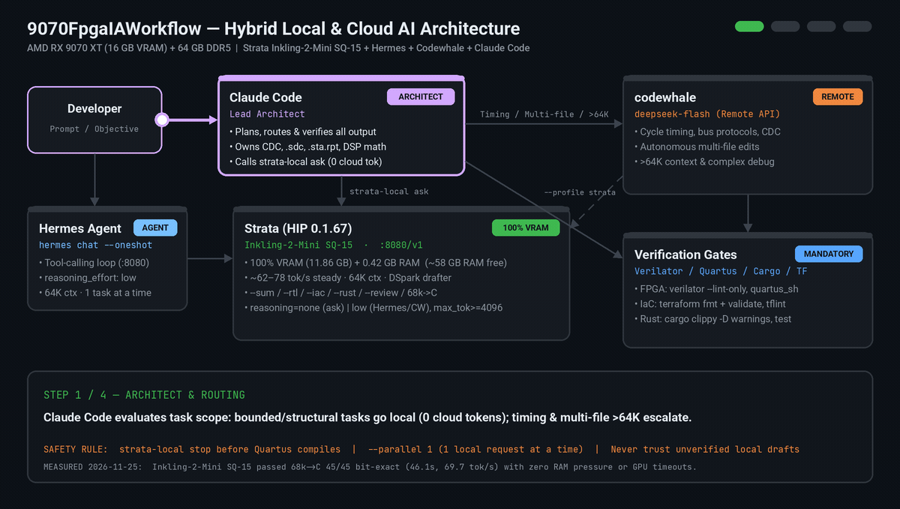
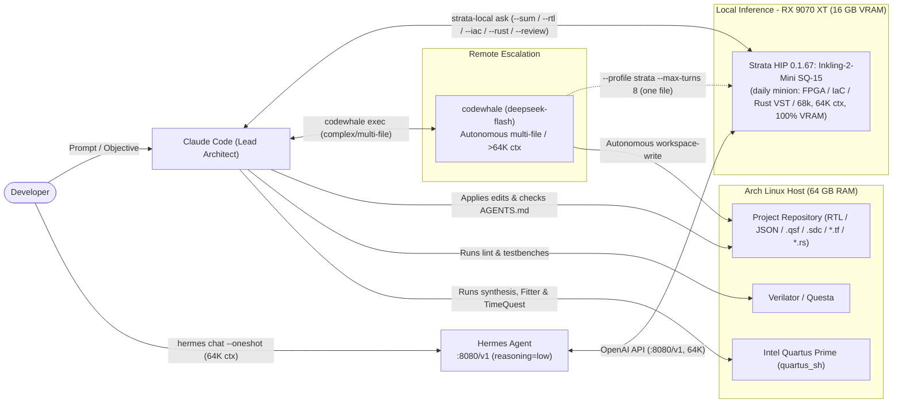
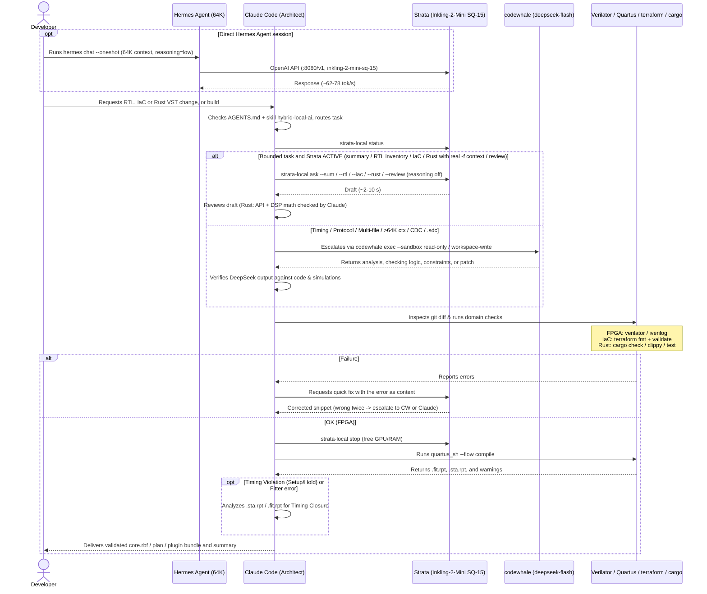
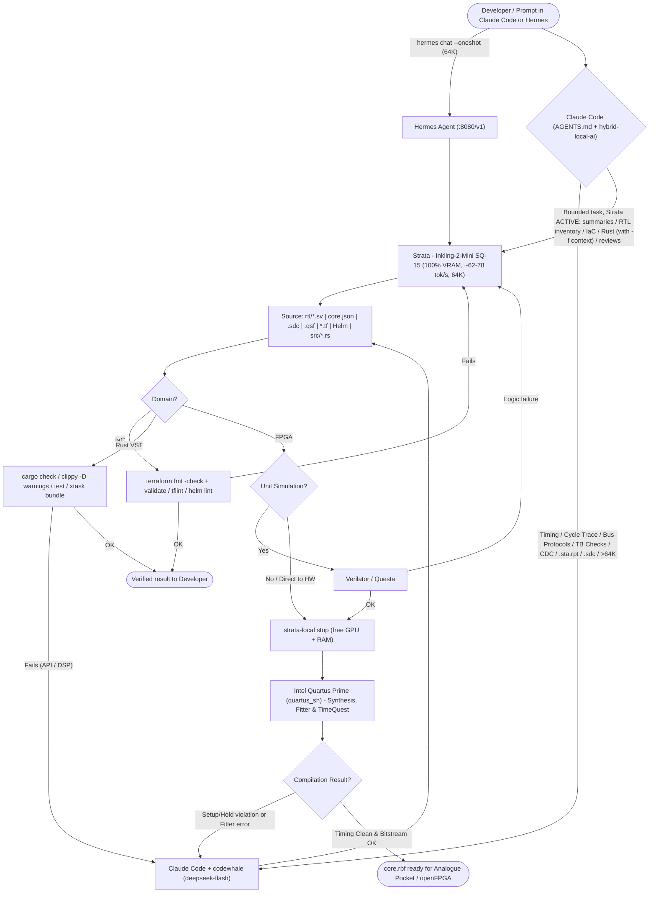

# Hybrid openFPGA + Intel Quartus Prime Development Workflow

Agent-assisted development architecture where **Claude Code** acts as the lead architect, offloading bounded reading, summaries, structural RTL inventory, and boilerplate to **Strata** (**`Inkling-2-Mini SQ-15`** running 100% on **RX 9070 XT 16 GB VRAM** via **HIP 0.1.67**), running **Hermes Agent** or `codewhale --profile strata` for bounded local tool-calling, escalating timing/protocol reasoning and autonomous multi-file tasks (>64K context) to **`codewhale`** (`deepseek-flash`), and running local toolchains (**Verilator / Icarus Verilog / Questa / Intel Quartus Prime**) on **64 GB DDR5 RAM**.

---

## 1. Integration Architecture (`Claude Code + Strata + Hermes + codewhale`)

**Strata** serves **`Inkling-2-Mini SQ-15`** (64K context) 100% in VRAM (`11.86 GB` experts + DSpark in VRAM, `~0.42 GB` in RAM), leaving **~45–58 GB** of system RAM free for Quartus Prime and simulation.

> [!IMPORTANT]
> **Structural-Only Boundary for Local Models:** Strata (`Inkling-2-Mini SQ-15`) is used **only** for summaries, structural/inventory work, boilerplate, and first-pass reviews. It must **not** be used for timing, cycle-by-cycle behaviour of registered logic, clock/phase reasoning, or bus protocols. All timing/protocol reasoning routes to `codewhale` (`deepseek-flash`) or Claude Code.

---

## 2. Process & Interaction Diagram

---

## 3. Decision and Synthesis Flow

---

## Hardware Resource Allocation (Arch Linux)

| Component | Allocated Resource | Role in Pipeline |
| :--- | :--- | :--- |
| **AMD RX 9070 XT (16 GB)** | ~16 GB VRAM | **Strata** (`Inkling-2-Mini SQ-15`, 11.86 GB experts + DSpark in VRAM, 64K ctx) via `strata-local`, Hermes Agent, or `codewhale --profile strata` |
| **Intel i7-14700KF / i9-14900K** | CPU Compute | RTL simulation (Verilator/Questa) and Quartus Place & Route |
| **64 GB DDR5 RAM** | ~0.4 GB to Strata while running | ~58 GB remains free; still stop Strata before Quartus compiles |
| **Claude Code + `codewhale`** | Remote API | Lead architecture, CDC, `.sdc`, `.sta.rpt` / `.fit.rpt` analysis, and multi-file edits (`deepseek-flash`) |
