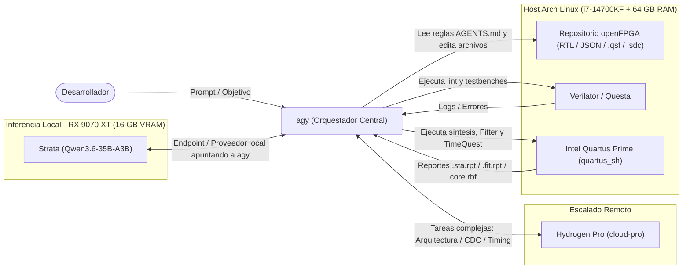
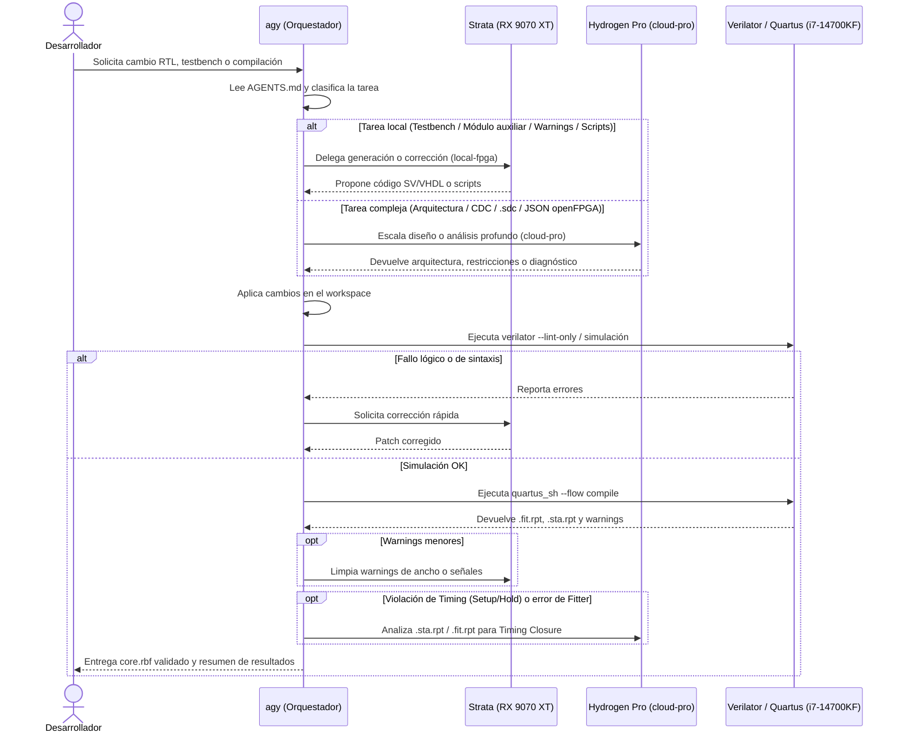
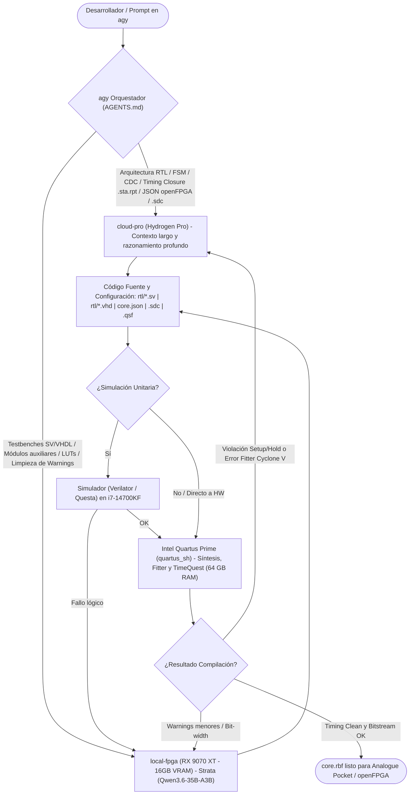

# Flujo Híbrido de Desarrollo openFPGA + Intel Quartus Prime

Arquitectura de desarrollo asistido por agentes donde **Strata** se conecta/apunta a **`agy` (Antigravity)** y **`agy` actúa como orquestador central**, coordinando el razonamiento local en **Strata** (**RX 9070 XT 16 GB VRAM**), el escalado en la nube (**Hydrogen Pro**) y la ejecución de herramientas locales (**Verilator / Questa / Intel Quartus Prime**) sobre **i7-14700KF + 64 GB DDR5 RAM**.

---

## 1. Arquitectura de Integración (`Strata -> agy`)

**Strata** expone el modelo local (`Qwen3.6-35B-A3B` en la RX 9070 XT) apuntando hacia **`agy`**, de modo que **`agy`** centraliza la lectura del proyecto (`AGENTS.md`), el enrutamiento de tareas, la edición de archivos y la ejecución de compilaciones y simulaciones.

---

## 2. Diagrama de Procesos e Interacción (Orquestación por `agy`)

---

## 3. Flujo de Decisión y Síntesis

---

## Distribución de Recursos de Hardware (Arch Linux)

| Componente | Recurso Asignado | Función en el Pipeline |
| :--- | :--- | :--- |
| **AMD RX 9070 XT (16 GB)** | ~14–15 GB VRAM | Inferencia local con **Strata** (`Qwen3.6-35B-A3B`) conectado a `agy` |
| **Intel i7-14700KF (20 cores)** | Cómputo CPU | Orquestación (`agy`), simulación RTL (Verilator/Questa) y Place & Route de Quartus |
| **64 GB DDR5 RAM** | ~12–16 GB Quartus + Offload | Compilación Cyclone V sin swapping + capas MoE excedentes de Strata |
| **Hydrogen (Cuenta Pro)** | API Remota | Escalado desde `agy` para arquitectura, CDC, `.sdc` y análisis de `.sta.rpt` / `.fit.rpt` |
