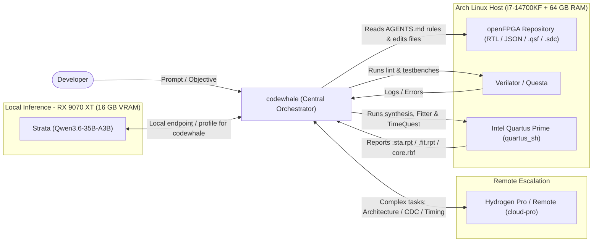
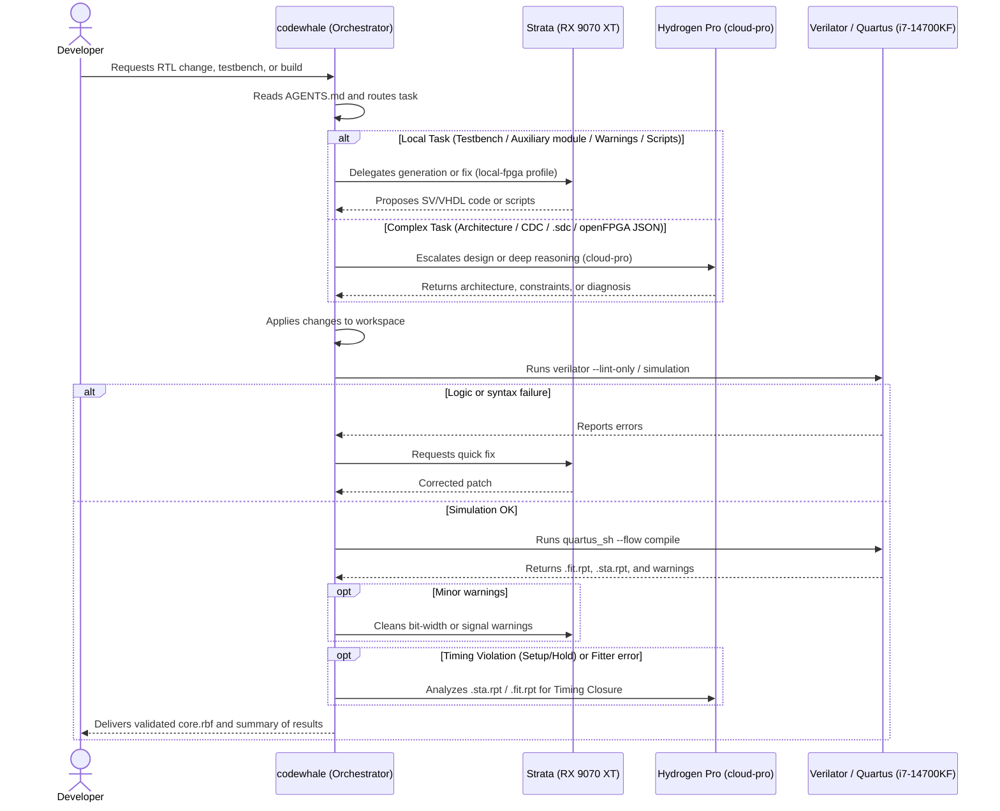
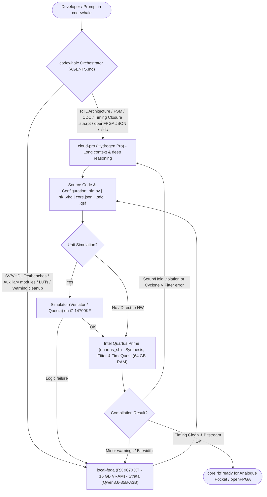

# Hybrid openFPGA + Intel Quartus Prime Development Workflow

Agent-assisted development architecture where **Strata** interfaces with **`codewhale`** and **`codewhale` acts as the central orchestrator**, coordinating local reasoning in **Strata** (**RX 9070 XT 16 GB VRAM**), cloud escalation (**Remote / Cloud Models**), and local tool execution (**Verilator / Questa / Intel Quartus Prime**) on **i7-14700KF + 64 GB DDR5 RAM**.

---

## 1. Integration Architecture (`Strata -> codewhale`)

**Strata** exposes the local model (`Qwen3.6-35B-A3B` on the RX 9070 XT) to **`codewhale`**, so that **`codewhale`** centralizes project rules parsing ([`AGENTS.md`](../AGENTS.md)), task routing, file editing, and the execution of builds and simulations.

---

## 2. Process & Interaction Diagram (Orchestrated by `codewhale`)

---

## 3. Decision and Synthesis Flow

---

## Hardware Resource Allocation (Arch Linux)

| Component | Allocated Resource | Role in Pipeline |
| :--- | :--- | :--- |
| **AMD RX 9070 XT (16 GB)** | ~14–15 GB VRAM | Local inference with **Strata** (`Qwen3.6-35B-A3B`) connected to `codewhale` |
| **Intel i7-14700KF (20 cores)** | CPU Compute | Orchestration (`codewhale`), RTL simulation (Verilator/Questa), and Quartus Place & Route |
| **64 GB DDR5 RAM** | ~12–16 GB Quartus + Offload | Cyclone V compilation without swapping + Strata MoE layer offload |
| **Hydrogen (Pro Account)** | Remote API | Escalation from `codewhale` for architecture, CDC, `.sdc`, and `.sta.rpt` / `.fit.rpt` analysis |
