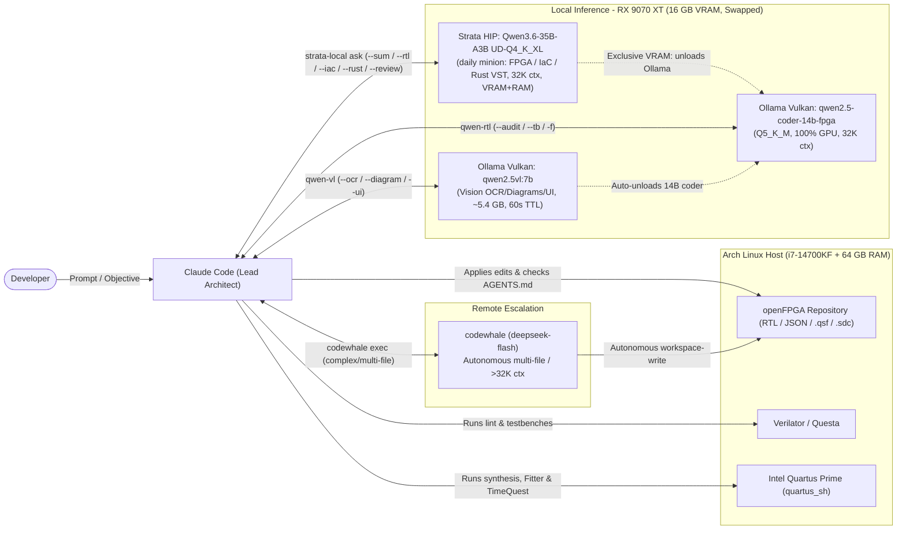
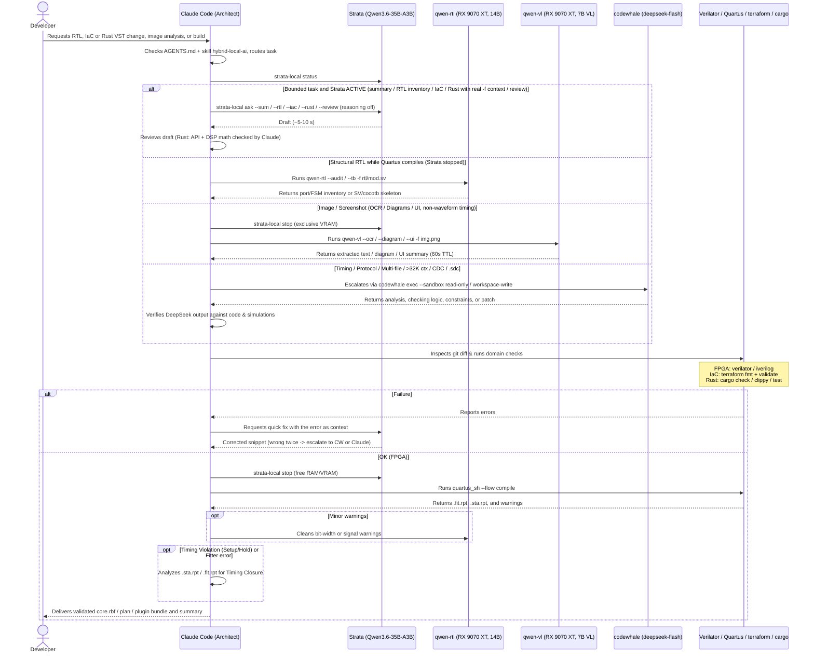
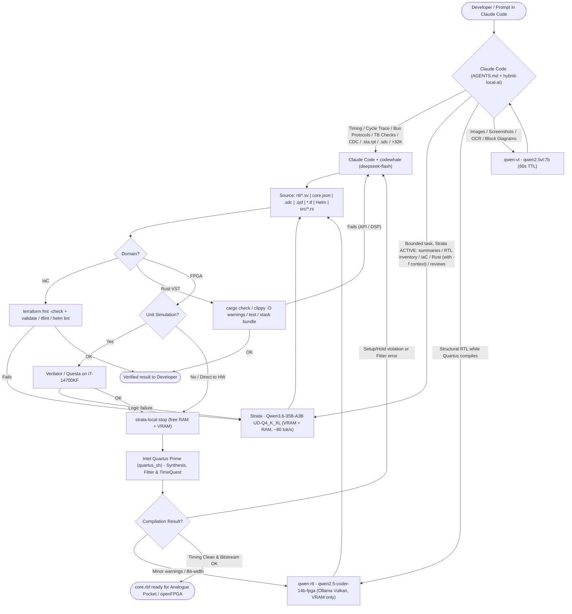

# Hybrid openFPGA + Intel Quartus Prime Development Workflow

Agent-assisted development architecture where **Claude Code** acts as the lead architect, offloading structural RTL reading and testbench skeletons to **`qwen-rtl`** (**`qwen2.5-coder-14b-fpga`** running 100% on **RX 9070 XT 16 GB VRAM** via **Ollama Vulkan**), escalating timing/protocol reasoning and autonomous multi-file tasks (>32K context) to **`codewhale`** (`deepseek-flash`), and running local toolchains (**Verilator / Icarus Verilog / Questa / Intel Quartus Prime**) on **i7-14700KF + 64 GB DDR5 RAM**.

---

## 1. Integration Architecture (`Claude Code + qwen-rtl + codewhale`)

**Ollama Vulkan** serves **`qwen2.5-coder-14b-fpga`** (`Q5_K_M`, 32K context) 100% in VRAM. **`qwen-rtl`** sends RTL files/stdin directly to Ollama's `/api/chat` endpoint and returns structural summaries or testbench skeletons to Claude Code, avoiding tool-calling overhead while keeping all ~62 GB of system RAM free for Quartus Prime.

> [!IMPORTANT]
> **Structural-Only Boundary for `qwen-rtl`:** Qwen is used **only** for structural/inventory work, boilerplate, and testbench skeletons. It must **not** be used for timing, cycle-by-cycle behaviour of registered logic, clock/phase reasoning, or bus protocols (measured 2026-11-17 on `psk_sram.sv`: structural inventory was accurate, but its cycle trace ignored the one-clock register delay and invented `OE#`/bus contention). All timing/protocol reasoning routes to `codewhale` (`deepseek-flash`) or Claude Code.

---

## 2. Process & Interaction Diagram

---

## 3. Decision and Synthesis Flow

---

## Hardware Resource Allocation (Arch Linux)

| Component | Allocated Resource | Role in Pipeline |
| :--- | :--- | :--- |
| **AMD RX 9070 XT (16 GB)** | ~16 GB VRAM, exclusive | **Strata** (Qwen3.6-35B-A3B, 81/256 experts per layer in VRAM) via `strata-local`, **or** Ollama Vulkan (`qwen2.5-coder-14b-fpga`, `qwen2.5vl:7b`) via `qwen-rtl` / `qwen-vl` |
| **Intel i7-14700KF (20 cores)** | CPU Compute | RTL simulation (Verilator/Questa) and Quartus Place & Route |
| **64 GB DDR5 RAM** | ~12-16 GB to Strata while running | Remaining Strata experts; stop Strata before Quartus so compilation gets the full RAM |
| **Claude Code + `codewhale`** | Remote API | Lead architecture, CDC, `.sdc`, `.sta.rpt` / `.fit.rpt` analysis, and multi-file edits (`deepseek-flash`) |
